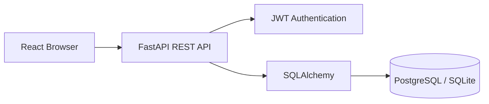

# CampusConnect 🎓

**A full-stack campus discovery platform** for exploring courses, enrolling in classes, and saving student opportunities. Built by **Aqib Ali** as a software engineering portfolio project.

> **Demo project, not affiliated with Berea College or any university.** The seeded courses, instructors, schedules, enrollment capacities, and opportunities are illustrative sample data, **not verified current listings**. No real enrollments or applications are submitted to institutions.

## Tech stack

| Layer | Stack |
| --- | --- |
| Frontend | React 19, Vite, Lucide React, responsive CSS |
| Backend | Python, FastAPI, Pydantic |
| Database | PostgreSQL via Docker; SQLite for quick local development |
| Auth | Argon2 password hashing; signed, expiring JWT bearer tokens |
| Tooling | Docker Compose, GitHub Actions, pytest, HTTPX |

## Features

- 📚 Search and filter courses by title, code, or department
- ✅ Create an account, sign in, enroll in courses, and drop enrollments
- 💼 Browse research, internship, volunteer, and event opportunities
- 🔖 Save opportunities to a personalized shortlist
- 📊 Personal overview with totals for courses, enrollments, opportunities, and bookmarks
- 📱 Responsive UI for mobile and desktop
- 🔌 Documented REST API at `/docs`
- 🧪 API integration tests and continuous integration checks

## Quick start — Option A: Docker (PostgreSQL)

Install [Docker Desktop](https://www.docker.com/products/docker-desktop/) and Git. Open a terminal in this folder:

```bash
# Optional but recommended: create .env from .env.example, and change SECRET_KEY
docker compose up --build
```

Open **http://localhost:5173**. API documentation: **http://localhost:8000/docs**.

The Docker configuration is for local development only; do not use its default database password or secret key in production.

## Quick start — Option B: without Docker (SQLite)

Requirements: Python 3.11+, Node.js 20.19+ or 22+, npm.

**Terminal 1 — backend:**

```bash
cd backend
python -m venv .venv
# Windows PowerShell:
.venv\Scripts\Activate.ps1
# macOS/Linux: source .venv/bin/activate
pip install -r requirements.txt
uvicorn app.main:app --reload
```

**Terminal 2 — frontend:**

```bash
cd frontend
npm install
npm run dev
```

Navigate to **http://localhost:5173**. The backend automatically creates `backend/campusconnect.db` with sample content. The Vite development server proxies `/api` requests to the FastAPI server.

## Test

```bash
cd backend
pytest -q
```

```bash
cd frontend
npm run build
```

## API overview

| Method | Route | Function |
| --- | --- | --- |
| GET | `/api/health` | Check server |
| POST | `/api/auth/register` | Create account |
| POST | `/api/auth/login` | Obtain JWT |
| GET | `/api/users/me` | Current user |
| GET | `/api/courses` | Browse courses; `search`, `department` filters |
| GET | `/api/enrollments` | My enrollment IDs (auth required) |
| POST / DELETE | `/api/enrollments/{course_id}` | Enroll or drop (auth required) |
| GET | `/api/opportunities` | Browse opportunities; `search`, `kind` filters |
| GET | `/api/bookmarks` | My saved opportunity IDs (auth required) |
| POST / DELETE | `/api/bookmarks/{id}` | Save or unsave (auth required) |

### Example: register

```bash
curl -X POST http://localhost:8000/api/auth/register \
  -H "Content-Type: application/json" \
  -d '{"name":"Demo User","email":"demo@example.com","password":"test-pass-123"}'
```

## Structure

```text
CampusConnect/
├── backend/
│   ├── app/
│   │   ├── main.py           # REST endpoints
│   │   ├── auth.py           # Auth/JWT
│   │   ├── database.py       # SQLAlchemy configuration
│   │   ├── models.py         # Database tables
│   │   ├── schemas.py        # API validation
│   │   └── seed.py           # Demo-only sample content
│   └── tests/test_api.py
├── frontend/src/
│   ├── main.jsx              # React app
│   └── styles.css            # Responsive UI
├── docker-compose.yml
└── .github/workflows/test.yml
```

## Architecture



## Security & design notes

- Passwords are hashed with Argon2 and never returned by the API.
- Endpoints that change student-specific data require a valid JWT.
- Course capacity is checked server-side; on PostgreSQL, enrollments lock the course row for concurrency safety.
- Unique database constraints prevent duplicate enrollments and bookmarks.
- Tokens are stored in `localStorage` for demo simplicity; a production app should use a more robust session strategy (e.g. HttpOnly secure cookies with CSRF protections), rate limiting, migrations, secret management, HTTPS, logging, and stricter deployment settings.
- This prototype has no admin console, verified third-party opportunities, real school registration integration, or email verification.

## Future roadmap

- [ ] Admin moderation and verified opportunity submissions
- [ ] Course schedule conflict detection and waitlists
- [ ] Pagination, end-to-end tests, and accessibility audit
- [ ] Alembic migrations and production deployment
- [ ] Search relevance and recommendation engine

## Author

**Aqib Ali**  
[GitHub](https://github.com/aqibsolangiali) · [LinkedIn](https://www.linkedin.com/in/aqib-ali-54b872443)
