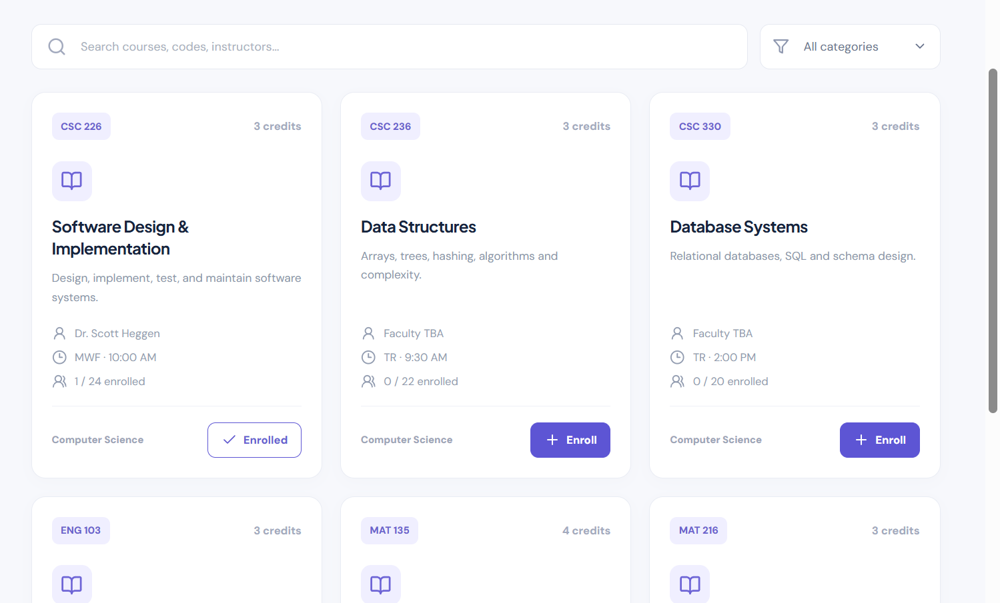
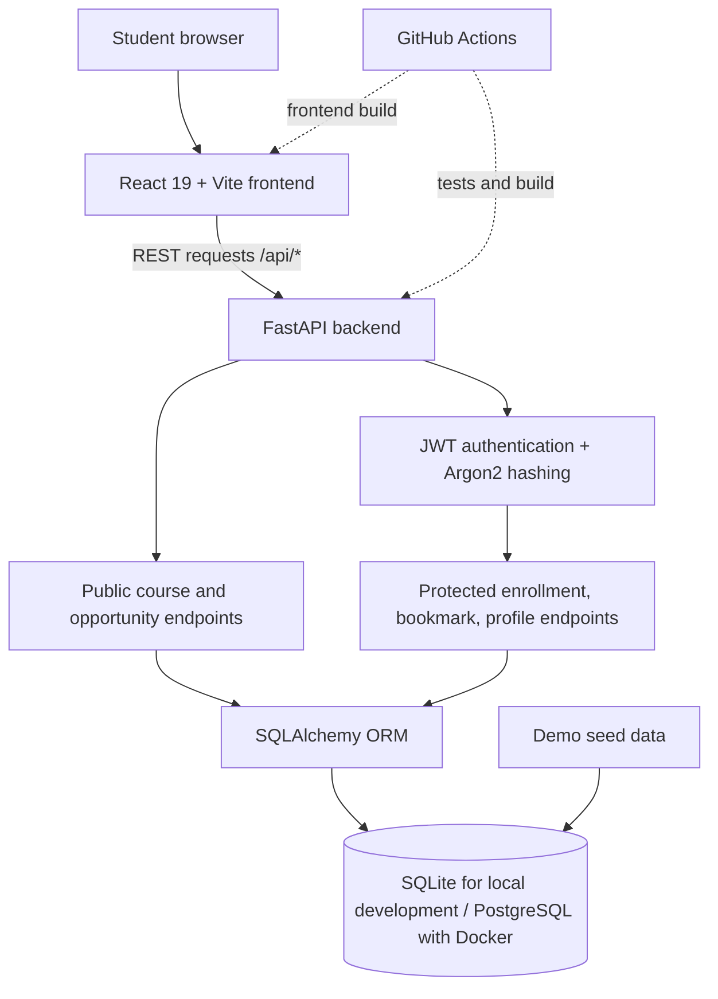

<div align="center">

# 🎓 CampusConnect

### Explore courses. Discover opportunities. Build your campus journey.

**A full-stack campus discovery and student workspace built with React, FastAPI, and SQLAlchemy.**

[](https://react.dev/)
[](https://fastapi.tiangolo.com/)
[](https://www.postgresql.org/)
[](https://github.com/aqibsolangiali/CampusConnect/actions/workflows/test.yml)
[](https://github.com/aqibsolangiali/CampusConnect)

**[🌐 Explore Live Demo](https://campusconnect-web-mvbs.onrender.com/)** · **[🔌 API Documentation](https://campusconnect-1-l4h2.onrender.com/docs)** · **[📂 Source Code](https://github.com/aqibsolangiali/CampusConnect)**

</div>

> **Portfolio demonstration, not an official college system.** All seeded course offerings, instructors, class times, capacity figures, and opportunity listings are sample data. Enrolling or bookmarking here changes only the demonstration database; it **does not** register anyone at a university or submit an internship application.

---

## The problem

Academic planning and opportunity discovery often happen across disconnected pages and tools. **CampusConnect explores a single-workspace alternative:** browse sample courses, find student opportunities, and organize what interests you through a personalized dashboard.

I built this application to practice and demonstrate the engineering behind a complete product—not just a static frontend—including client-server communication, authentication, relational data modeling, API design, state management, and cloud deployment.

## Product preview



*Real screenshot of the CampusConnect course catalog from the development/demo application. Course information is illustrative.*

> More product screenshots—dashboard, opportunity discovery, and personalized workspace—can be added to `assets/screenshots/` as they are captured.

## What CampusConnect can do

| Experience | What I implemented | Access |
| :--- | :--- | :--- |
| **Student dashboard** | Displays totals for available courses, opportunities, current enrollments, and saved items | Public overview; personalized counts after sign-in |
| **Course discovery** | Search by course title/code/instructor, filter by department, view schedule, credits, and live demo enrollment counts | Public |
| **Account creation and sign-in** | Validated registration, Argon2 password hashing, signed expiring JWT access tokens | Public auth routes |
| **Enroll / drop** | Enroll in and withdraw from sample courses, with duplicate and capacity checks | Signed-in users |
| **Opportunity explorer** | Browse sample research, internship, volunteer, event, and hackathon listings | Public |
| **Saved opportunities** | Bookmark or remove opportunities and view a personal shortlist | Signed-in users |
| **Responsive interface** | Desktop and smaller-screen layouts, reusable cards, navigation, feedback messages, and sign-in modal | All visitors |
| **Documented API** | FastAPI OpenAPI documentation and JSON REST endpoints | `/docs` |
| **Automated checks** | Pytest API integration tests and frontend production build in GitHub Actions | Repository CI |

### Explore the full workflow

1. **Discover** sample courses and opportunities without an account.
2. **Create a demo account** to unlock personalized features. Use a unique test password.
3. **Enroll** in a sample course and see the enrollment status update.
4. **Bookmark** a sample opportunity and return to it from your saved items.
5. **Manage** your demo dashboard, course enrollments, and shortlist from one interface.

## System architecture



**Deployment model:** Render hosts the React static site and Python web service independently. In the accompanying upgrade, the React client accepts `VITE_API_URL` so it can call a separate API origin in production while retaining Vite's `/api` development proxy locally.

Read [Architecture & Design Decisions](docs/ARCHITECTURE.md) for more detail.

## Technology stack

| Layer | Technologies | What they power |
| :--- | :--- | :--- |
| **Frontend** | React 19, Vite, JavaScript, CSS, Lucide React | Interactive interface, component rendering, responsive layouts, client-side state |
| **Backend** | Python, FastAPI, Pydantic | REST endpoints, request validation, OpenAPI schema |
| **Persistence** | SQLAlchemy, SQLite, PostgreSQL | Relational models, enrollment/bookmark records, development and Docker databases |
| **Identity** | Argon2 (`pwdlib`), PyJWT | Password hashing and signed, expiring bearer-token sessions |
| **Quality** | Pytest, HTTPX/TestClient, GitHub Actions | API integration checks and frontend build verification |
| **Delivery** | Docker Compose, Render, Git/GitHub | Local services, hosted demo, version control |

## Engineering highlights

**Architected a client-server application.** Implemented a React interface consuming a FastAPI JSON API, with separate services for a frontend and backend deployed on Render.

**Designed relational data models.** Structured users, courses, enrollments, opportunities, and bookmarks with SQLAlchemy; used unique constraints to prevent duplicate enrollment and saved-opportunity records.

**Implemented student-specific workflows.** Built authenticated enrollment and bookmarking routes; scoped personalized records to the signed-in user.

**Enforced core enrollment rules.** Added server-side duplicate checks, capacity validation, and a row-locking approach for databases supporting `SELECT ... FOR UPDATE` (such as PostgreSQL). SQLite does not provide equivalent row-level locking guarantees.

**Built discoverability and stateful UX.** Added searchable/filterable catalogs, course status indicators, opportunity saves, counts, responsive navigation, and feedback notifications.

**Introduced automated quality checks.** Configured a GitHub Actions workflow to run backend tests and build the frontend on pushes and pull requests. The badge reflects the actual workflow status rather than a manually claimed pass rate.

## Getting started

### Requirements

- Python **3.11+**
- Node.js **20.19+ or 22+** and npm (for Vite 6)
- Git; Docker Desktop is optional

### Option A — Run locally without Docker (SQLite)

Open **two separate terminals** from the project folder.

**Terminal 1 — API**

```powershell
cd backend
py -3.12 -m venv .venv
.\.venv\Scripts\python.exe -m pip install -r requirements.txt
.\.venv\Scripts\python.exe -m uvicorn app.main:app --reload --port 8000
```

**Terminal 2 — frontend**

```powershell
cd frontend
npm install
npm run dev
```

Visit **http://localhost:5173**. API docs: **http://localhost:8000/docs**.

On macOS/Linux, activate the virtual environment using your shell's instructions and replace the Windows `py` / `Scripts` commands with your Python environment's equivalents.

During local development, Vite forwards browser requests beginning with `/api` to `http://127.0.0.1:8000`. The backend creates a local SQLite database and seeds fictional content when started.

### Option B — Docker Compose (PostgreSQL)

For a local multi-service environment, create a root `.env` file from `.env.example`, replace `SECRET_KEY` with a long random secret, then run:

```bash
docker compose up --build
```

Open **http://localhost:5173**. The Compose configuration provisions a PostgreSQL container, FastAPI backend, and Vite frontend. **The example database password is development-only.**

## API reference

| Method | Path | Description | Auth |
| :--- | :--- | :--- | :--- |
| `GET` | `/api/health` | API health | No |
| `POST` | `/api/auth/register` | Create a demo account | No |
| `POST` | `/api/auth/login` | Log in and receive a JWT | No |
| `GET` | `/api/users/me` | Read your account | Yes |
| `GET` | `/api/courses` | List/filter demo courses | No |
| `GET` | `/api/enrollments` | List your enrolled course IDs | Yes |
| `POST` | `/api/enrollments/{course_id}` | Enroll in a demo course | Yes |
| `DELETE` | `/api/enrollments/{course_id}` | Drop a demo course | Yes |
| `GET` | `/api/opportunities` | List/filter demo opportunities | No |
| `GET` | `/api/bookmarks` | List your saved opportunity IDs | Yes |
| `POST` | `/api/bookmarks/{opportunity_id}` | Save an opportunity | Yes |
| `DELETE` | `/api/bookmarks/{opportunity_id}` | Remove a saved opportunity | Yes |

For interactive endpoint parameters and request schemas, open [Swagger UI on the hosted backend](https://campusconnect-1-l4h2.onrender.com/docs) or locally at `http://localhost:8000/docs`.

## Tests & continuous integration

The repository contains tests for API health, course catalog access, account registration, protected resources, enrollment, and bookmarking—including duplicate enrollment rejection and removal workflows.

```powershell
cd backend
python -m pytest -q
```

Then verify the React production bundle:

```powershell
cd frontend
npm run build
```

GitHub Actions executes both checks on pushes and pull requests. **No performance, scale, accessibility, or security audit result is claimed here.** See the [live CI workflow](https://github.com/aqibsolangiali/CampusConnect/actions/workflows/test.yml) for the current outcome.

## Deploy to Render

| Service | Type | Root directory | Build | Start / output |
| :--- | :--- | :--- | :--- | :--- |
| API | Python Web Service | `backend` | `pip install -r requirements.txt` | `uvicorn app.main:app --host 0.0.0.0 --port $PORT` |
| UI | Static Site | `frontend` | `npm install && npm run build` | Publish `dist` |

**Required environment configuration:**

- **Backend**: `SECRET_KEY` = a new long random value; `CORS_ORIGINS` = `https://campusconnect-web-mvbs.onrender.com`; use a durable `DATABASE_URL` if demo accounts must survive restarts.
- **Frontend**: `VITE_API_URL` = `https://campusconnect-1-l4h2.onrender.com` (without `/api` at the end). Save, **rebuild and redeploy** the static site.

**Important:** The frontend's `VITE_API_URL` setting works with the companion `frontend/src/main.jsx` change provided in this upgrade package. Setting the variable on an unmodified older frontend will not fix API routing by itself.

The current SQLite fallback is not durable on hosts with ephemeral filesystems. For data retention, use a persistent database. Read the detailed [Render deployment guide](docs/DEPLOYMENT.md).

## Project structure

```text
CampusConnect/
├── .github/workflows/test.yml     # API test + frontend build CI
├── assets/screenshots/            # Real product screenshots
├── backend/
│   ├── app/
│   │   ├── main.py                # REST endpoints and lifespan
│   │   ├── auth.py                # Password hashing and JWT validation
│   │   ├── database.py            # SQLAlchemy engine/session
│   │   ├── models.py              # ORM models
│   │   ├── schemas.py             # Request/response validation
│   │   └── seed.py                # Fictional sample listings
│   └── tests/test_api.py
├── frontend/
│   ├── src/main.jsx               # React UI and configurable API origin
│   ├── src/styles.css             # Responsive styling
│   └── .env.example               # Optional public Vite API origin
├── docs/
│   ├── ARCHITECTURE.md
│   └── DEPLOYMENT.md
├── SECURITY.md
└── docker-compose.yml
```

## Security, privacy & limitations

This is a **learning-focused portfolio prototype**, not a university registration service or production-ready multi-tenant platform.

- Demo passwords are hashed with Argon2; JWT-protected routes identify the current user.
- The client currently stores tokens in `localStorage`. A production version should use a more robust session design such as secure, HttpOnly cookies with suitable CSRF protections.
- The source has a development fallback JWT secret. **Set a strong, private `SECRET_KEY` in the deployed backend before using any accounts.** Never commit this value.
- The demonstration does not implement email verification, rate limiting, an admin moderation workflow, verified real-world listings, audit logging, database migrations, or university enrollment integrations.
- Sample data may mention real institutions or people but **should not be treated as their actual schedules or official offerings**.
- Avoid using a real password or entering sensitive personal data in a public demo.

See [SECURITY.md](SECURITY.md) for responsible disclosure and current limitations.

## Roadmap

- [ ] Security hardening: login throttling, robust session storage, email verification, production secret validation
- [ ] Persistent hosted PostgreSQL and Alembic database migrations
- [ ] Verified opportunities, admin moderation, and institution integration pathways
- [ ] Course waitlists, schedule conflict detection, richer filters and pagination
- [ ] End-to-end browser tests, accessibility review, better error and loading states
- [ ] Search quality evaluation and optional personalized discovery features

## About the developer

Created by **[Aqib Ali](https://github.com/aqibsolangiali)** as an independent full-stack engineering portfolio project.

**[GitHub](https://github.com/aqibsolangiali)** · **[LinkedIn](https://www.linkedin.com/in/aqib-ali-54b872443)** · **[Try CampusConnect](https://campusconnect-web-mvbs.onrender.com/)**

*CampusConnect is not officially affiliated with Berea College or any other educational institution.*
