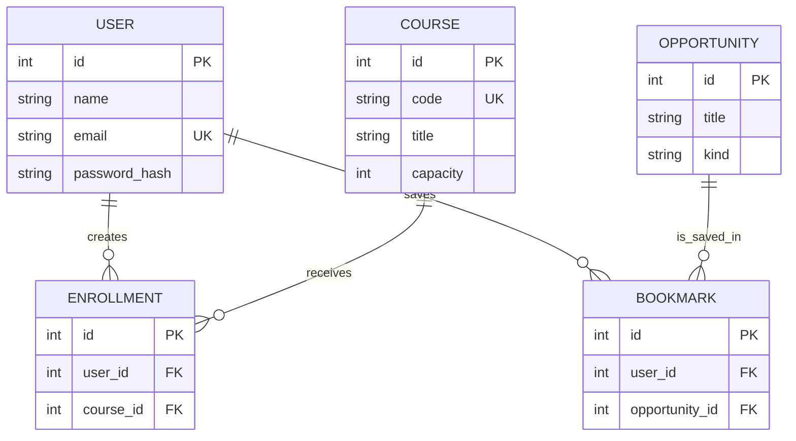

# Architecture & Engineering Decisions

CampusConnect is a React + FastAPI portfolio prototype with separate public catalog and authenticated personalized workflows.

## Runtime data flow

```mermaid
sequenceDiagram
    participant Student as Student Browser
    participant UI as React App
    participant API as FastAPI
    participant DB as SQLAlchemy Database
    Student->>UI: Browse courses
    UI->>API: GET /api/courses
    API->>DB: Query courses + enrollment counts
    DB-->>API: Rows
    API-->>UI: JSON course cards
    Student->>UI: Sign in
    UI->>API: POST /api/auth/login
    API->>DB: Find user
    API-->>UI: Signed JWT
    Student->>UI: Enroll in sample course
    UI->>API: POST /api/enrollments/{id} + bearer token
    API->>DB: Check ownership, duplicates, capacity; insert row
    API-->>UI: Success or explicit error
```

## Relational schema



## Architectural choices

- **React + Vite**: client-side state for tab navigation, filters, current user, course enrollments, and bookmarks; minimal JS toolchain.
- **FastAPI + Pydantic**: explicit request/response validation and automatically generated OpenAPI documentation.
- **SQLAlchemy**: portable ORM models used with local SQLite and Docker PostgreSQL.
- **JWT + Argon2**: signed expiring bearer tokens and one-way password hashing; production session handling needs hardening.
- **Server-side checks**: duplicate enrollment and bookmarks prevented by database unique constraints and API errors; capacity checked on write.
- **Concurrency limits**: PostgreSQL row locking is used when checking enrollment capacity, but SQLite does not offer equivalent row-level locks; production load testing is not included.
- **Seed data**: six fictional courses and five fictional opportunities are inserted when tables are empty; not a live university feed.
- **Hosted frontend/backend**: build-time `VITE_API_URL` permits cross-origin requests, and backend `CORS_ORIGINS` specifies allowed browser origins. CORS does not serve as authentication.

## Known trade-offs

1. Current frontend stores JWT in localStorage; susceptible to token theft if an XSS vulnerability is introduced.
2. Default development secret is unsafe for public accounts without environment override.
3. Backend uses `create_all` instead of versioned database migrations.
4. No email verification, abuse prevention/rate limits, centralized logs, or production observability.
5. Browser UI is mostly implemented in one JSX module; future refactor into smaller components can improve maintainability.
6. No verification of listed courses/opportunities against real institutions.

## Next engineering milestones

Prioritize security and persistence first; after that, introduce modular frontend components, end-to-end testing, accessibility audits, rate limiting, and observed metrics.
